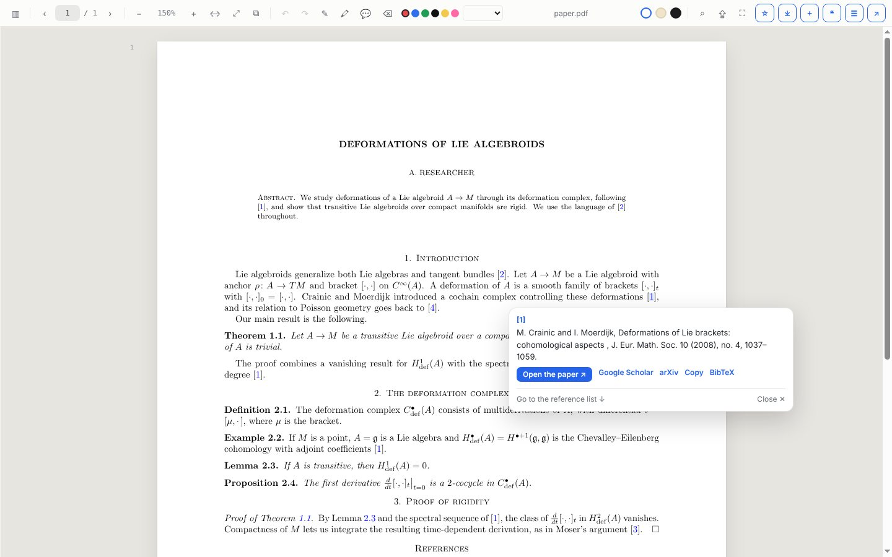
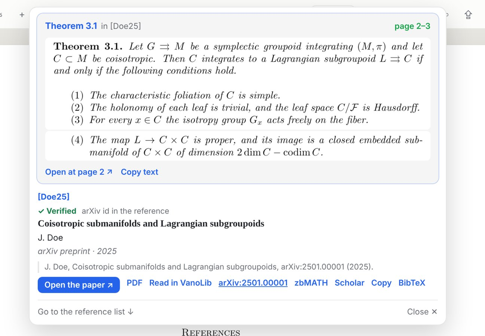
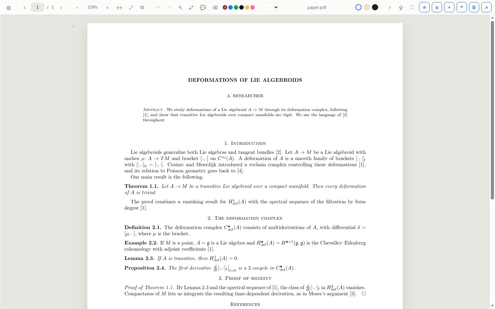
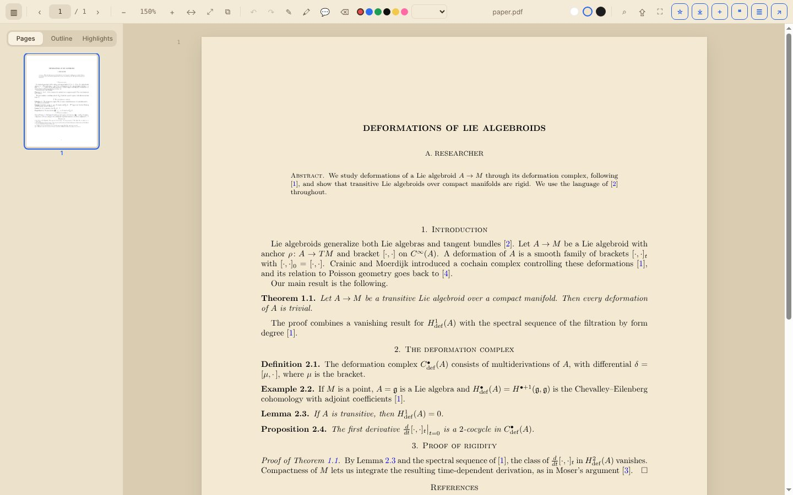
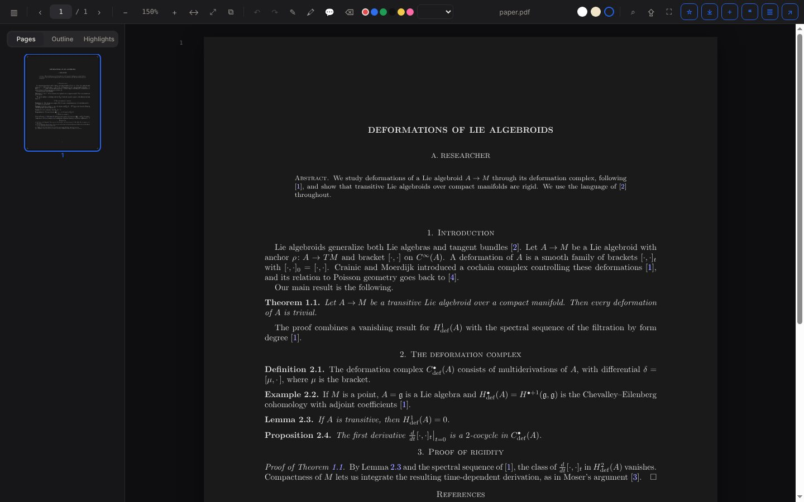

<h1 align="center">VanoLib Reader</h1>

<b>A better PDF reader for papers, right in your browser.</b> 
Click a citation and see the reference instantly, and even the exact lemma it points to. Highlight, annotate, save for later, read at night.

<a href="README.fr.md">Version française</a>

---

## What's new in 1.7

- **The exact statement behind a citation.** Click `[May25, Lemma 2.1]` and the card shows Lemma 2.1 itself, cut from the cited paper's own PDF (arXiv or open access), with its page number. Formulas look exactly as in the paper. It works for theorems, lemmas, propositions, corollaries, definitions, remarks and examples, abbreviations such as `Thm. 3.4`, lettered results such as `Theorem A`, equations `(2.4)` and sections `§3.1`, and also when the citation wraps to the next line. Click the statement, or **Open at page …**, to read the cited paper at that very place.
- **Honest when it cannot.** If the paper has no open-access PDF, if the paper numbers the result differently (it calls it "Lemma 2.1" when you cited "Theorem 2.1"), or if the statement is read from the arXiv version of a published paper, the card says so.

Also since 1.0: **verified references** (each entry is checked against Crossref and arXiv, marked ✓ Verified or ≈ Probable match), a **Research panel** (the paper, papers citing it, related papers, verified references, one-click .bib export), **previews** of theorem and equation links on hover, and **full-text search** across the PDFs of your reading list.

Version 1.0.0 is still available on the [releases page](https://github.com/yassine-aitmohamed/vanolib-extension/releases).

## Why VanoLib Reader

Reading a paper in the browser's built-in PDF viewer means scrolling back and forth to the reference list, losing your place, and starting from zero every time you reopen the file. VanoLib Reader fixes that.

- **Citation cards.** Click or hover a citation such as `[5]` and the full reference appears in a card, checked against Crossref and arXiv, with one-click links to the paper, Google Scholar and arXiv, plus Copy and BibTeX. "Go to the reference list" jumps there with a Back button.
- **Exact statements.** For a citation such as `[May25, Lemma 2.1]`, the card also shows the statement of Lemma 2.1, taken from the cited paper itself.
- **Research panel.** The open paper, the papers that cite it, related papers and its verified references, with .bib export.
- **Annotate like on paper.** Pen, highlighter in four colours, underline, notes on the page and comments on a passage, with undo and redo. Every annotation is saved per PDF and listed in the sidebar.
- **Reading list, offline.** Save a PDF with ⌘D / Ctrl+D: it stays readable offline, and reopens at the page where you stopped, with your highlights. Search the full text of all your saved PDFs.
- **Comfortable reading.** Sharp text at every zoom, day, sepia and night modes, search, outline and page thumbnails.
- **One-click download** to a dedicated folder, and **send to VanoAtlas** if you use [VanoAtlas](https://github.com/yassine-aitmohamed/vanoatlas).
- **Private.** Your PDFs, notes and reading list stay in your browser. No account, no tracking, no server of ours. To check references and show statements, the reader asks public scholarly services (Crossref, arXiv, Semantic Scholar) about the papers you cite.
- **Free and open source** (MIT).

## Screenshots

| | |
|---|---|
|  **Reader**: sharp text, toolbar with annotation tools. |  **Citation card**: the reference, without leaving the page. |
|  **Exact statement**: `[Doe25, Theorem 3.1]` shows Theorem 3.1 itself. | |
|  **Sepia mode** with pages, outline and highlights in the sidebar. |  **Night mode** for late reading. |

## Install

VanoLib Reader works in **Google Chrome, Microsoft Edge, Brave, Arc, Vivaldi and Opera**, on **macOS and Windows** (and Linux). The steps are the same on every system.

1. **Download** `vanolib-extension.zip` from the [latest release](https://github.com/yassine-aitmohamed/vanolib-extension/releases/latest) and unzip it.
   - macOS: double-click the zip in Finder.
   - Windows: right-click the zip → **Extract All…**
2. **Open the extensions page** of your browser:
   - Chrome, Brave, Arc, Vivaldi: type `chrome://extensions` in the address bar
   - Edge: type `edge://extensions`
3. Turn on **Developer mode** (top right in Chrome, left side in Edge).
4. Click **Load unpacked** and choose the unzipped **`extension`** folder (the one that contains `manifest.json`).
5. Pin VanoLib Reader to the toolbar (puzzle icon → pin).

Open any PDF link: it opens in VanoLib Reader. To read PDFs from your own disk, open the extension's **Details** and turn on **Allow access to file URLs**.

To update, download the new version, replace the folder, and click ↻ **Reload** on the VanoLib Reader card.

## Keyboard shortcuts

| Action | macOS | Windows |
|---|---|---|
| Save to reading list | ⌘D | Ctrl+D |
| Download | ⌘S | Ctrl+S |
| Undo / Redo | ⌘Z / ⌘⇧Z | Ctrl+Z / Ctrl+Shift+Z |
| Pen / Highlighter / Note / Eraser | P / H / N / E | P / H / N / E |

## Tips

- If Google Scholar PDF Reader is also installed, turn one of them off so that both do not open the same PDF.
- Turn automatic opening on or off from the toolbar icon.
- The VanoAtlas port (default 8770) can be changed from the toolbar icon.

## License

MIT. See [LICENSE](LICENSE).
